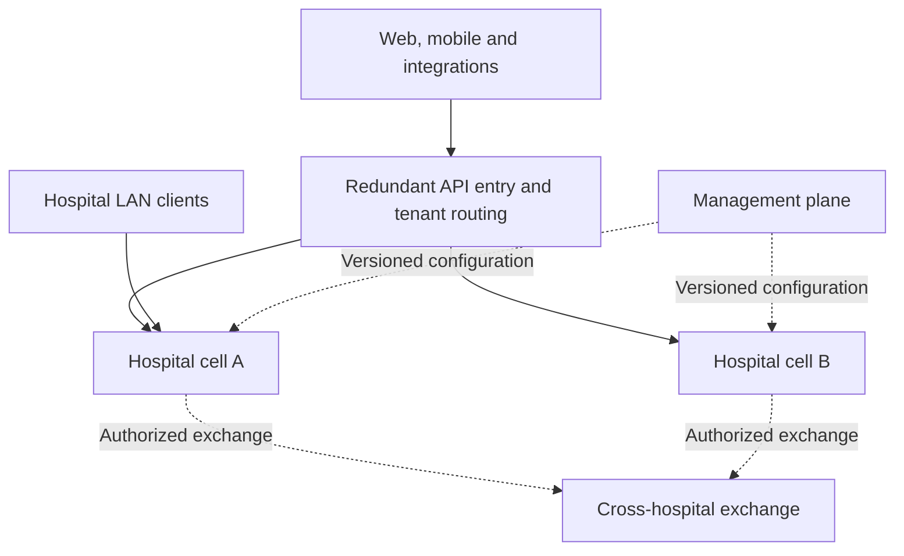

# SYNQORIA — Platform Architecture and Specification

**Africa medical intelligence synchronized**

Version 2.1 | 23 October 2026 | Expanded architecture and gap-resolution baseline

Revision note: expands the former 15 grouped domains into 40 canonical modules (28 business/clinical and 12 platform/governance modules). Sections 20–32 define the new normative detail. The initial deployment ownership below remains applicable, but the canonical module count comes exclusively from section 20. A module is a product capability, not necessarily a separate service. This revision resolves specification omissions and explicitly gates items that require external clinical, operational or workload evidence. No software tests or capacity certifications are claimed.

Status: proposed architecture and implementation plan. This is not deployed software, a capacity certification or a declaration of regulatory compliance. Numerical objectives require measurement before contractual commitment. MUST denotes a proposed release requirement.

## 1. Architecture decision

Official platform name: **SYNQORIA**. Official tagline: **Africa medical intelligence synchronized**. SYNQORIA is the name of the EMR/HMS platform described throughout this specification. This naming update does not change the architecture, module IDs or validation requirements.

Build an API-first, domain-driven platform deployed in isolated hospital cells. Within each cell, use a modular transactional clinical core and independently deployable domain services. PostgreSQL owns authoritative state; transactional outboxes distribute committed changes; durable read models support queries; Redis provides selective acceleration. Clinical revisions, integration events and security audits are separate records with separate lifecycles.

A cell is an independently operated deployment serving a hospital or hospital group. It is not a microservice or an automatic disaster-recovery replica. Essential clinical operations must not synchronously depend on another cell or a central management plane.

Microservices are used for domains with clear ownership and independent operational needs. The clinical core initially remains one deployable application with strict internal modules and multiple runtime instances. This preserves a transaction boundary for tightly related safety decisions. Later extraction requires evidence and a new consistency design.

## 2. Workload assumptions and open decisions

| ID | Baseline assumption | Required confirmation |
|---|---|---|
| A01 | 1,000,000 encounters/month across the platform | Whether this means per hospital, network-wide, or registered patients |
| A02 | High daytime and shift-change peaks | Hourly traffic, concurrent staff and device volumes |
| A03 | Hospital-local operation is required for selected sites | Local hardware, power, networking and support capabilities |
| A04 | EN/FR interfaces | Clinical terminology, forms and document language requirements |
| A05 | Java/Spring is proposed for this design | Supported version matrix and existing-system migration assessment |
| A06 | FHIR version is selected per partner contract | Implementation guides, partner versions and terminology licenses |
| A07 | Multi-tenant and dedicated deployments | Residency, retention, isolation tier and operating budget |
| A08 | Clinical content has accountable owners | Clinical safety lead and medication-content owner |

No existing codebase has been audited for this plan. This document does not authorize or require rewriting an existing Laravel system. Backend selection must account for the actual team, existing assets and benchmark evidence.

## 3. Deployment topology

The routing layer uses authenticated tenant context, never an unverified hospital header. Each service rechecks tenant identity and resource authorization. Local endpoints remain available during internet outages where local deployment is provided.

The management plane handles provisioning, placement, configuration and fleet releases. Existing cells retain signed, versioned configuration and approved local identity capability when it is unavailable. Expiry and revocation policies remain explicit; cached policy does not grant indefinite access.

Cells have independent authoritative data, credentials, capacity budgets and essential messaging failure boundaries. Sharing a global database, identity dependency or broker can defeat isolation; record and test each shared dependency. Central analytics consumes data asynchronously and is outside the clinical commit path.

Place hospitals/groups in cells according to capacity, residency and operating requirements. Do not split by department when routine care would require cross-cell transactions. Cross-cell patient identity matching does not confer access permission.

## 4. Initial deployment ownership groups

| Domain | Authoritative responsibilities | Initial deployment |
|---|---|---|
| Patient identity | Identifiers, demographics, unknown patients, merge/unmerge lineage | Clinical core module |
| Encounters/ADT | Visits, admissions, transfers, discharge, bed occupancy | Clinical core module |
| Clinical chart | Notes, diagnoses, observations, allergies, signed amendments | Clinical core modules |
| Medication authorization | Orders, safety assessments, overrides, cancellation | Clinical core; patient-safety transaction boundary |
| Medication administration | Dose events, omissions, corrections, bedside checks | Clinical core initially |
| Laboratory | Accessioning, specimens, worklists, analyzers, verified/amended results | Independent service |
| Imaging | Orders, reports, study references and PACS integration | Independent service |
| Pharmacy/inventory | Stock, batches, expiry, reservations, dispensing | Independent service |
| Revenue cycle | Tariffs, charges, invoices, payments, claims, reconciliation | Independent service |
| Scheduling | Appointments, calendars and resource reservations | Independent service |
| Integration | FHIR/HL7 adapters, partner contracts, delivery monitoring | Independent service |
| Notifications | SMS/email/push and delivery outcomes | Independent workers |
| Audit archival | Protected retention, verification, authorized audit search | Separate security boundary |
| Reporting | Operational projections and analytics | Separate read infrastructure |
| Identity/access | Federation, credentials and policy management | Redundant with defined local continuity |

Service-owned storage is private: other services cannot write its tables. Within the core, enforce module ownership through interfaces, dependency rules and architecture tests. Shared physical infrastructure inside a cell is a documented failure domain, not independent isolation.

The 15 rows above group deployments; they are not the canonical module inventory. Section 20 expands their capabilities and the previously deferred HMS scope into stable module IDs, workflow contracts and delivery waves. Specialized clinical submodules require clinical validation before enablement.

## 5. Technology specification

| Layer | Proposed baseline | Constraint |
|---|---|---|
| Web | React/Next.js with TypeScript | Accessible EN/FR workflows and consistent design tokens |
| Mobile | React Native/Expo where capabilities fit | Enrolled devices, encrypted storage and bounded offline scope |
| Backend | Java/Spring Boot | Pin supported releases and upgrade policy before implementation |
| Authoritative database | PostgreSQL | HA, pooled connections, integrity constraints, restore automation |
| Messaging | Kafka with transactional outbox | Delivery ownership, retention, capacity and replay policies |
| CDC | Debezium | Explicit outbox mapping and WAL/replication-slot monitoring |
| Cache | Redis | Rebuildable data; never sole clinical authority |
| API edge | Kong or equivalent | Edition based on required controls and support |
| Identity | OIDC-compatible provider | Federation, MFA, local continuity and revocation tested |
| Documents/images | Encrypted object storage and PACS | Integrity hashes, access controls, quarantine and retention |
| Deployment | Containers; Kubernetes where operationally justified | Staff capability and tested recovery required |
| Observability | OpenTelemetry-compatible telemetry | Correlation without unnecessary patient data |

Use one principal backend language initially. Separate Go query services require profiling evidence. Enterprise licenses are procurement decisions. Long-term durability requires supported upgrades and migration compatibility rather than freezing technology versions.

## 6. Data and integrity rules

Tenant-owned records MUST include tenant_id and stable opaque IDs. Enforce tenant-scoped foreign keys/uniqueness so an ID cannot link a record to another tenant. Apply service-level checks and database isolation controls with non-bypass application roles.

Core entity groups:

- Patient: identifier/system/issuer, aliases, unknown/partial/estimated demographics, deceased status and identity lineage. Emergency registration cannot require invented names or birth dates.
- Encounter: patient, facility, location, care team, type, status, effective times and version.
- Allergy: terminology system/code/version or uncoded description, verification and clinical status, reactions, source, author and onset. Record not-assessed, unknown and explicit no-known-allergy assessments separately.
- Medication order: product/ingredient, dose, unit, route, schedule, indication, prescriber, encounter, status, assessment and version.
- Safety assessment: input versions, safety revision, rule/content version, findings, decision and override evidence.
- Clinical revision: immutable revision ID, entity/version, preserved content/change, author, reason, authored/effective/recorded times and signature references.
- Financial ledger: fixed-precision amount/currency, immutable posted entries, reversals and reconciliation references.
- Infrastructure: idempotency records, outbox, consumer inbox/deduplication, audit capture and synchronization checkpoints.

Version fields MUST be enforced using conditional writes or ORM versioning. They do not increment themselves. Current-state uniqueness is distinct from history uniqueness; adding revision numbers to a unique key does not enforce one active record. Clinical owners approve allergy reconciliation and terminology equivalence rules.

Signed notes cannot be silently overwritten. Amendments reference the preserved signed version. Distinguish clinical effective time from system recording time. Do not store entire imaging studies or unbounded patient charts in event payloads or cache entries.

## 7. Clinical concurrency protocol

Maintain a tenant/patient safety row with a safety_revision. Relevant mutations and medication authorization lock this row before reading safety inputs. Every registered safety-input mutation uses the same protocol and increments the revision. Acquire multiple locks in stable order. Keep transactions short and exclude slow external calls.

Medication authorization:

1. Authenticate; authorize patient and encounter access; validate the command.
2. Claim or resolve its scoped idempotency record.
3. Lock patient safety state; read authoritative inputs.
4. Evaluate locally available approved rules; identify missing/stale inputs.
5. Reject, request review or apply an authorized override according to policy.
6. Save order, assessment, revision, local command audit, idempotency result and outbox intent.
7. Commit before returning success.

An external lab result becomes authoritative for this decision after validated ingestion. Locking does not reveal facts that have not arrived. A new allergy or relevant result after commitment triggers reassessment of affected orders. Dispensing and administration require their own current-state checks; earlier authorization is not permanent clearance.

## 8. Cross-service workflow contracts

| Workflow | Minimum states | Required safeguards |
|---|---|---|
| ADT | Proposed, admitted, transfer requested, transferred, discharge planned, discharged | Atomic bed reservation, cancellation/correction history, approved temporary locations |
| Laboratory | Requested, accepted/rejected, collected, received, processing, verified, amended | Stable order/specimen IDs; event publication is not acceptance; critical result acknowledgement/escalation |
| Pharmacy | Requested, reserved, clinical release approved, dispensed/exception | Atomic stock, expiring version-bound authorization, cancellation-race handling |
| Medication administration | Due, assessed, administered/omitted/refused, corrected | Correct patient/order/dose; duplicate prevention; late-entry provenance |
| Billing | Evaluated, charged, invoiced, paid/reconciled/reversed | Event deduplication, payment idempotency, reversal rather than posted-data overwrite |

For pharmacy, define exactly when release becomes authorized and how concurrent cancellation is handled. Network loss means pending/exception, never implicit approval. Physical dispensing cannot be reversed by a software compensation. Clinical review must approve exceptional release and downtime procedures.

Each workflow specification includes actors, prerequisites, transitions, invariants, commands, events, timeouts, UI states, audit evidence and recovery actions. Financial holds and emergency access follow explicit hospital policy rather than accidental dependency failures.

## 9. API-first / API-as-a-product contract

Use OpenAPI 3.1 with a pinned patch and validated toolchain; this is a chosen compatibility baseline, not a claim about the latest version. Use separate event schemas. FHIR integrations publish a pinned CapabilityStatement and applicable implementation-guide profiles.

Mandatory conventions:

- Versioned endpoints; additive changes preferred; breaking changes require migration and deprecation.
- OAuth/OIDC, scoped machine identities and service-level resource authorization.
- Idempotency-Key for retryable effects, scoped by tenant/caller/operation. Same key with changed payload returns conflict. Document retention and business deduplication after expiry.
- ETag/If-Match on updates; 412 for stale preconditions, 409 for business conflict, 422 for semantic validation, 503 for unavailability, 429 with retry guidance for throttling.
- Structured problem responses, stable error codes and correlation IDs; no stack traces or unnecessary PHI.
- Cursor pagination, bounded queries/uploads/exports and allowlisted sort/filter fields.
- Committed entity version on writes; projection asOf and source version/watermark on reads.
- Read-your-writes uses bounded projection waiting or authoritative fallback.
- Async operations return 202 plus a status resource; acceptance is not completion.
- Signed authenticated webhooks with event IDs, replay protection, filtering and bounded retries.

API families: patients/identifiers/merges; encounters/ADT; allergy assessments; notes/signatures/amendments; medication orders/assessments/administrations; lab orders/specimens/results; imaging orders/reports; stock/reservations/dispenses; invoices/payments; appointments; consent/access; audit search; operational status.

Developer product: synthetic-data sandbox, documentation, example integrations, SDK generation, changelog, quotas, support policy and onboarding/revocation. Browser validation never replaces backend validation.

## 10. Event processing and read models

Envelope: eventId, tenantId, sourceCellId, aggregateType, aggregateId, aggregateVersion, partitionKey, eventType, schemaVersion, occurredAt, recordedAt, correlationId, causationId and payload. Do not include credentials. Minimize clinical data to the consumer's legitimate purpose.

Outbox persistence is atomic with state; Kafka delivery remains asynchronous. Map actual columns in Debezium configuration. Monitor WAL retention and connector lag. Cleanup respects capture acknowledgement and recovery windows. Outbox is not the permanent audit or replay archive.

Ordering is partition-local. Patient partition keys do not replace allergy/order aggregate identity. Consumers atomically persist deduplication with local effects, detect version gaps and quarantine poison events. External actions require receiver idempotency or reconciliation. Bounded retry/backoff/jitter prevents overload.

Rebuild projections into a new generation, validate, then switch. Replays cannot resend notifications, charge accounts or dispense medication. Define retained event archive and/or snapshot-plus-delta rebuilding.

Durable PostgreSQL projections serve worklists and summaries. Redis caches bounded authorized views with tenant-aware keys, TTLs, invalidation, stampede controls and bounded fallback. Critical checks use authoritative data. Bulk reporting is isolated from clinical query capacity.

## 11. Identity, privacy and audit

Use RBAC plus tenant, facility, care relationship, purpose, consent and record-sensitivity attributes. Department/shift alone is insufficient. Administrative permissions do not imply clinical access. Privileged access requires MFA and separation of duties.

Emergency access records reason, scope, duration, visible indication and retrospective review. Machine credentials are scoped and rotated. Revocation and local outage behavior are explicit.

Capture reads, exports, modifications, denials, emergency access, logins and policy changes. Record actor, resource/patient references, purpose, policy version, outcome, timestamps and correlation. Base64 query data is not encrypted; avoid unnecessary name/query duplication.

Command audit persists with the transaction. Failed/denied actions use an independent path so rollback does not erase evidence. Read/export authorization attempts are durably captured before disclosure; completion/failure is separately recorded. Exports fail closed if durable capture is unavailable. Emergency clinical access uses an approved alternate accountable capture process rather than silent log loss.

Use independently protected retention, restricted writes, retention locks where applicable, cryptographic verification and anchored checkpoints. Hash chains alone do not prevent privileged deletion/rewrite. AuditEvent and Provenance mappings require validation against pinned FHIR profiles and real code-system URLs. Formatting is not immutability or compliance.

Retention, residency and cross-border rules require jurisdiction-specific assessment before production; no universal duration is assumed.

## 12. Offline and hospital-local deployment

Separate internet outage, hospital-server outage and device disconnection. Local cells need local APIs, identity capability, database redundancy, audit/event storage, monitored LAN and backup power. A single desktop is not an enterprise HA deployment.

Assign one authoritative site/epoch to each mutable aggregate. Do not allow unrestricted conflicting central and local writes during disconnection. Ownership transfer requires fencing and reconciliation. Replicas expose source/version and last-sync time.

Disconnected devices support allowlisted drafts/captures with encrypted minimal PHI, enrollment and expiry. Pending commands remain visibly pending and are reauthorized/revalidated on ingestion. Offline queued prescriptions are not represented as centrally authorized.

Synchronization uses stable IDs, checkpoints, checksums, deduplication and explicit conflicts. No silent last-write-wins for clinical decisions. Patient merge/unmerge, medication changes and signed amendments require dedicated review workflows.

## 13. Capacity model and provisional SLOs

At 1,000,000 visits per 30-day month: approximately 33,333/day and 0.386 visits/second averaged over 24 hours. An illustrative 500 requests/visit yields 500 million/month, 193 requests/second average and 1,929 at a 10x peak. This excludes separately modeled imaging, device feeds and bulk jobs.

Measure concurrency, write ratio, payload distributions, longitudinal chart size, event fanout, storage retention and hourly peaks. Size cells by benchmarked bottlenecks, not patient count alone. Include indexes, replicas, backups and imaging in storage budgets.

| Objective | Provisional target | Qualification |
|---|---|---|
| Critical API availability | 99.95% monthly per cell | Correct completion within defined deadline; not fleet average |
| Bounded chart API | p95 <=500ms; p99 <=1.5s | Server edge-to-response; excludes bulk/image transfer |
| Clinical command | p95 <=750ms; p99 <=2s | Authorization through durable commit |
| Routine projection freshness | p99 <=5s normally | Not a safety-check guarantee |
| Capacity | Forecast peak with one app node unavailable; 2x peak surge exercise | Realistic historical dataset and request mix |
| Covered DB-node failure | RPO 0 acknowledged commits; RTO <=5min | Correct synchronous durability, fencing and tested failure scope |
| Entire site loss | RPO <=5min; RTO <=60min | Funded recovery site and functioning off-site replication |

All are objectives, not demonstrated guarantees. Site-loss RPO cannot be promised during prolonged disconnection. Synchronous replication can block writes when required acknowledgements are unavailable; document the durability/availability policy. Agree SLOs and budget before SLAs.

## 14. Resilience and operations

Multiple app instances span failure domains. Use deadlines, circuit breakers, retry budgets, priority queues and per-tenant limits. Shed optional reports/exports before clinical requests. Global routing and identity dependencies require their own resilience tests.

PostgreSQL needs connection budgets, index/query tuning, vacuum monitoring, replication lag alerts and fenced failover preventing two primaries. Replicas do not replace backups. Restore encrypted independent backups including objects, keys, audits and checkpoints; reconcile restored state.

Monitor outbox age, CDC/WAL growth, consumer lag, dead letters, locks, resource saturation, latency, audit failures, certificate expiry and backup age. Kafka outages permit bounded outbox growth only; prevent disk exhaustion. Redis loss triggers bounded fallback, not an unrestricted database stampede.

Enterprise operation requires incident ownership, on-call coverage, runbooks, escalation and regular drills. Hospital power and networking failures are part of the deployment model.

## 15. Release engineering and security

Reproducible builds, reviewed migrations, dependency/secret scans, SBOMs, signed artifacts and deployment provenance are required. Separate environments and use synthetic data by default. Infrastructure is version controlled.

Use staged cell rollouts. Database changes follow expand/migrate/contract and support rolling versions. Rollback does not undo every data migration; provide forward repair. Test contract compatibility and event evolution before rollout.

Threat modeling, penetration testing, tenant isolation and privileged-access review precede launch. Uploads enforce type/size validation, quarantine and malware checks. Keys/certificates have rotation and recovery procedures. No PHI in ordinary logs or notification previews by default.

Migration requires source inventory, mapping, dry runs, counts/checksums, identity reconciliation, clinical sampling, cutover freeze/delta strategy and rollback ownership. Preserve source provenance; do not automatically merge ambiguous patients.

## 16. Acceptance test matrix

| ID | Scenario | Acceptance evidence |
|---|---|---|
| T01 | Concurrent allergy change and medication order | Correct serial outcome, recorded input revision and reassessment |
| T02 | Retry after response loss | One business effect, original result returned |
| T03 | Same key, different request | Conflict, no new effect |
| T04 | Forged tenant/routing identifier | No disclosure/mutation; denial audited |
| T05 | Competing bed/stock operations | Capacity/quantity invariant preserved |
| T06 | Failure between state and outbox persistence | Entire transaction rolls back |
| T07 | Kafka/CDC outage/restart | Backlog recovered within storage budget; no duplicate effects |
| T08 | Duplicate/out-of-order events | Correct deduplication and version-gap handling |
| T09 | Projection replay | Validated rebuild without external side effects |
| T10 | Redis lost at peak | Approved clinical degradation limits maintained |
| T11 | Primary DB lost | Fenced failover, measured RPO/RTO, no split brain |
| T12 | Restore independent backup | Clinical records, objects, keys and audits reconcile |
| T13 | Read after successful write | Version-aware response or authoritative fallback |
| T14 | Audit capture unavailable | Export blocked; approved emergency procedure exercised |
| T15 | Internet outage/reconnect | Approved local work continues; conflicts visible |
| T16 | Identity revoked/offline grant expired | No silent indefinite authorization |
| T17 | Critical lab result notification fails | Acknowledgement/escalation remains durable |
| T18 | Bad release/incompatible event | Contained rollout and documented recovery |
| T19 | 72-hour soak plus peak/surge | No unbounded backlog/leaks or unacceptable tail latency |
| T20 | API/FHIR validation | Pinned validators and negative/compatibility tests pass |

Clinical owners define expected outcomes and overrides. Synthetic tests alone are not clinical validation. Release evidence links requirements, hazards, tests and unresolved risks.

## 17. Phased implementation plan — corrected dependencies

| Phase | Deliverables | Exit gate |
|---|---|---|
| P0 Discovery | Workload model, domain map, deployment tiers, hazard register, ADRs, SLOs | Decision owners and assumptions recorded |
| P1 Foundation | Repository boundaries, CI/CD, contracts, identity, tenancy, observability, migrations | Contract and isolation checks pass |
| P2 Transaction core | Patient/encounter, safety revision, idempotency, revisions, audit/outbox | T01-T06/T13 on real PostgreSQL |
| P3 Domain foundations | Actual lab, pharmacy, billing and scheduling services, durable handshakes and adapters | Producer/consumer contracts, acknowledgement, cancellation and deduplication tests pass |
| P4 Clinical vertical workflow | Registration through assessment, order, lab result, dispensing, administration and correction using P3 services | Clinician-reviewed normal/exception paths; no mock service accepted as production evidence |
| P5 Production cell | HA, backups, key recovery, isolation and staged deployment | Failure, restore and load objectives demonstrated |
| P6 Local/multi-cell | Local identity, synchronization, routing, ownership transfer | Outage and cross-cell isolation exercises pass |
| P7 Pilot | Training, reconciled migration, supervised use and incident rota | Clinical/security/operations approve scoped launch |
| P8 Expansion | Additional hospitals and specialty/HMS modules | Capacity and compatibility evidence for each expansion |

These are quality gates, not fixed-duration quotas. Start with a complete workflow rather than nonfunctional placeholders across every module. Production patient data must not enter unfinished prototypes.

## 18. Next engineering specifications

Produce ADRs for cell boundaries, consistency ownership, backend selection, tenant isolation, event retention, identity continuity and recovery policy. Then produce detailed workflow state machines, ER diagrams/migrations, OpenAPI and event schemas, FHIR mappings, executable load/failure harnesses and runbooks.

Before hardware sizing: confirm meaning of one million/month and peak concurrency. Before partner integration: confirm FHIR/HL7/PACS contracts. Before medication validation: approve rule content and overrides. Before production: resolve residency/retention and fund recovery/on-call capability.

## 19. Reference basis

This is a project design synthesis. These primary references support mechanisms, not the untested capacity targets:

- Cell isolation: https://docs.aws.amazon.com/wellarchitected/2023-10-03/framework/rel_fault_isolation_use_bulkhead.html
- Service data ownership: https://learn.microsoft.com/en-us/azure/architecture/microservices/design/data-considerations
- PostgreSQL isolation: https://www.postgresql.org/docs/current/transaction-iso.html
- PostgreSQL replication: https://www.postgresql.org/docs/current/warm-standby.html
- Debezium outbox: https://debezium.io/documentation/reference/stable/transformations/outbox-event-router.html
- OpenAPI reference: https://spec.openapis.org/oas/v3.1.1.html
- FHIR R5 security: https://hl7.org/fhir/R5/security.html
- FHIR R5 audit definitions: https://hl7.org/fhir/R5/auditevent-definitions.html
- FHIR R5 outcome terminology: https://hl7.org/fhir/R5/valueset-audit-event-outcome.html

Reviewed for this planning discussion on 23 October 2026. Pin implementation packages and revalidate version-specific behavior before release.

## 20. Canonical module register — 40 modules

Counting rule: M01–M28 are business/clinical capabilities; M29–M40 are platform/governance capabilities. No screens, phases, adapters or service instances are counted as additional modules. Each row has one authoritative owner. Feature enablement is per hospital, constrained by dependency and evidence gates. A disabled module cannot leave a live broken menu or silently accept commands.

Waves: A = first general-hospital pilot; B = inpatient/advanced-care expansion; C = extended HMS. Platform modules needed by a wave are required even when invisible to end users. Specialty services may not launch before their B-wave validation. Separate deployables can contain several modules.

| ID | Module and owned records | Owner / deployment | Wave | Minimum lifecycle and invariant |
|---|---|---|---|---|
| M01 | Patient registration and master identity; identifiers, merge lineage | Registration / core | A | provisional → identified → merged; reversible reviewed merge; IDs never reassigned |
| M02 | Appointments and resource scheduling | Scheduling / service | A | requested → confirmed → arrived → fulfilled; cancellation/no-show branches; no conflicting reservation |
| M03 | Triage, emergency intake and queues | Emergency care / core | A | waiting → assessed → prioritized → assigned → handed-over; reassessment/escalation; priority rules clinically approved |
| M04 | Encounters, admission, transfers, discharge and beds | ADT / core | A | planned → active → discharge-planned → discharged; transfer subworkflow; at most one active occupant per bed |
| M05 | Clinical notes, diagnoses and encounter documentation | Clinical records / core | A | draft → signed → amended; entered-in-error branch; signed content preserved |
| M06 | Observations, vitals and longitudinal clinical measurements | Clinical observations / core | A | captured → verified → corrected; invalidated branch; units/time/source retained |
| M07 | Allergies, intolerances and reconciliation | Allergy management / core | A | unassessed → assessed; item statuses independently tracked; no unknown-to-negative inference |
| M08 | Medication prescribing and reconciliation | Prescribing / core | A | draft → authorized → held/completed/discontinued; cancellation separate from fulfilment |
| M09 | Medication administration and dose records | Nursing medication / core | A | due → checked → administered; omitted/refused/held branches; one effect per dose ID |
| M10 | Nursing care plans, inpatient tasks and handovers | Nursing / core | B | planned → assigned → performed → reviewed; handover acknowledged; overdue work visible |
| M11 | Laboratory, specimens and result verification | Laboratory / service | A | requested → accepted → collected → received → processed → verified; reject/recollect/amend branches |
| M12 | Imaging, radiology workflow and PACS references | Imaging / service | A | requested → scheduled → acquired → reported → verified; amendment and cancellation history |
| M13 | Pharmacy dispensing and medication inventory | Pharmacy / service | A | reserve → authorize release → prepare → hand over → reconcile; batch/expiry and quantity traceable |
| M14 | Surgery, theatre, anesthesia and recovery | Perioperative care / core extension | B | proposed → booked → pre-op verified → in-procedure → recovery → completed; checklists and consent gates |
| M15 | Blood bank and transfusion | Transfusion / service plus bedside core interface | B | collected/received → screened → available → reserved → issued → administered/returned/discarded; patient/unit traceability |
| M16 | Referrals and care transitions | Care coordination / core | A | initiated → accepted/rejected → transferred → attended → closed; explicit receiving owner |
| M17 | Specialty clinical packages | Specialty leads / core extensions | B | registered → assessed → treatment/follow-up → closed; specialty-specific protocols and records |
| M18 | Patient portal, mobile access and proxy accounts | Patient engagement / service | A | invited → verified → active → suspended/closed; independent proxy authorization |
| M19 | Charges, invoices, cashier and payment reconciliation | Revenue / service | A | calculated → posted → invoiced → settled; refund/reversal/dispute branches; balanced ledger |
| M20 | Insurance, payer authorization and claims | Claims / revenue service | B | eligibility checked → authorized/denied → submitted → adjudicated → settled/appealed; claim version retained |
| M21 | Procurement and supplier management | Procurement / service | C | requisition → approved → ordered → received → matched → closed; separation of duties |
| M22 | General stores and non-medication inventory | Stores / service | B | receive → quarantine/available → reserve → issue → return/adjust; stock never silently overwritten |
| M23 | Assets, biomedical maintenance and facilities | Engineering / service | B | registered → commissioned → active → maintenance → returned/retired; unsafe devices unavailable |
| M24 | Human resources, staffing and payroll | HR / service | C | employed → rostered → attendance-approved → payroll-approved → paid; clinical privileges separate |
| M25 | Transport and ambulance coordination | Transport / service | B | requested → assigned → dispatched → arrived → completed; cancellation/escalation; handover record |
| M26 | Catering and dietary orders | Nutrition operations / service | C | prescribed → checked → prepared → delivered → acknowledged; dietary restrictions reconciled |
| M27 | Mortuary and decedent release | Mortuary / service | C | received → identified → stored → release-authorized → released; chain of custody and dual checks |
| M28 | Hospital operations and business intelligence | Analytics / read services | A | ingested → validated → published → revised; source freshness and access scope visible |
| M29 | Facility, department, location and service configuration | Administration / management plane + local copies | A | draft → reviewed → published → superseded; versioned impact analysis |
| M30 | Terminology, formularies and clinical rule content | Clinical informatics / local content service | A | imported → validated → clinically approved → activated → retired/rolled back; version pinned per decision |
| M31 | Forms, templates, documents and signatures | Document governance / core + object storage | A | template draft → approved → published; document draft → signed → amended; schema version preserved |
| M32 | Consent, privacy and disclosure governance | Privacy / core policy module | A | proposed → verified → active → expired/revoked/superseded; purpose, subject and recipient scope |
| M33 | Identity, access and workforce privileges | Security / local-capable IAM | A | invited → verified → credentialed → active → revoked; role/privilege approval and expiry |
| M34 | Audit, provenance and evidence retention | Security audit / independent archival | A | captured → sealed → archived → verified; retention/disposal authorized and evidenced |
| M35 | Interoperability and API developer product | Integration / service | A | partner onboarded → tested → enabled → suspended → retired; versioned contract and replay controls |
| M36 | Device, analyzer and bedside gateway integration | Device integration / local gateways | A | enrolled → mapped → active → quarantined/retired; patient-device association and clock quality |
| M37 | Notifications, communication and escalation | Communications / workers | A | queued → delivered → acknowledged; retry/escalate/failed; delivery is not clinical acknowledgement |
| M38 | Offline synchronization and ownership reconciliation | Sync operations / cell-local service | A | queued → validated → applied/conflicted → reviewed → reconciled; ownership epoch enforced |
| M39 | Tenant and cell lifecycle, routing and fleet releases | Platform operations / management plane | A | provisioning → qualified → active → draining → fenced → migrated/retired; one authoritative placement |
| M40 | Reliability, backup, recovery and operational telemetry | SRE / per-cell agents and operations tools | A | protected → monitored → incident → recovered → verified; independent restore evidence |

M17 package inventory: obstetrics/gynecology, pediatrics/neonatology, cardiology, dentistry, dermatology, endocrinology/chronic disease, oncology and rehabilitation. These are submodules, not extra entries in the 40-module count. Each needs its own clinical protocol and acceptance review before activation. Autonomous AI clinical decisions are excluded from this baseline; any future AI/CDSS component requires separate governance and safety assessment.

The register makes scope explicit; it does not claim every screen or specialty protocol is fully designed. Detailed module specifications are required deliverables under section 31, not permission to improvise missing rules during implementation.

## 21. Workload profiles and admission control

Adopt two named planning profiles until the business target is confirmed: NETWORK-1M = one million visits/month across the fleet; HOSPITAL-1M = one million visits/month at one hospital. Test the latter on a dedicated deployment; fleet capacity cannot demonstrate individual-hospital capacity. Do not claim the higher profile until it passes the same full workflow suite.

Each workload manifest MUST contain: profile ID, sites, visits/day and peak hour, staff by role, concurrent sessions, read/write mix, request sizes, database history, patient-history percentiles, lab/device rates, imaging bytes/day, events per command, retention, batch workloads and network characteristics. Product owns these inputs; SRE owns the executable load model. Unknown fields are explicitly estimated with ranges and sensitivity tests.

Proposed synthetic stress envelope (test inputs, not measured hospital facts): 10,000 simultaneous staff sessions, 2,000 sustained ordinary API requests/second, 4,000 requests/second for a 15-minute surge, 20% effectful commands, and 10 years of synthetic history including very large charts. Device and imaging loads run as separate concurrent workloads once their volume manifests exist. Model realistic think time and hot patients; don't convert all activity into uniform random reads.

Define safe cell capacity C as the highest tested load that passes latency, correctness, backlog and recovery limits while losing one intended application failure domain. Operate below 60% of C during forecast steady peaks initially; warn at 70%, stop onboarding at 80%, and reduce optional workloads before 90%. Percentages apply to the limiting measured resource/workload, not CPU alone. Rebenchmark after material schema, rules, hardware or deployment changes.

Capacity reservations are tenant-scoped; bulk exports/rebuilds have separate worker and connection pools. Hospital enrollment is blocked when required headroom, backup or HA evidence is absent. A larger cell is provisioned or a controlled migration is scheduled before exhaustion.

## 22. Clinical safety protocol — explicit execution rules

### 22.1 Safety ownership

patient_safety_state is unique by (tenant_id, patient_id). safety_revision increases for mutations to registered decision inputs: allergy state/assessment, medication orders and administrations affecting interactions, reconciled medication history, clinically relevant observations/results, pregnancy status and demographic corrections used by rules. The rule-input registry declares which source fields affect which decision. New rules cannot depend on an unregistered asynchronously updated field without changing the registry and tests.

Writers are named: M01 demographic corrections; M06 observations; M07 allergy commands; M08 medication commands; M09 administration; and the core ingress handlers accepting verified M11/M12 data. Integration adapters call these handlers; they never write safety tables directly. Waveform/raw device samples do not each acquire a patient lock: M36 validates and aggregates where the approved protocol allows, then publishes selected observations with source-time and freshness metadata.

All guarded transactions use PostgreSQL READ COMMITTED and acquire the safety-row lock before reading inputs. Read inputs in subsequent statements after lock acquisition; no pre-lock snapshot or ORM cache may serve these reads. Within a transaction, lock all affected safety rows sorted by tenant/patient ID, then orders sorted by ID, then dose/release rows. Cross-tenant multi-patient commands are forbidden. Identity merge locks both patients, freezes relevant transitions and reconciles references before reopening; it is not an ordinary demographic edit.

Initial transaction settings: 500ms lock wait budget, 2s statement timeout and 3s total command deadline, subject to benchmark tuning. Deadlocks/serialization failures receive at most two whole-transaction retries with jitter within the original deadline. Failed attempts roll back entirely. Exhausted transient lock budget returns 503 with bounded retry guidance and a status lookup option; stale version returns 412. No remote service call occurs while a database lock is held.

The guard serializes known facts; it does not predict new facts arriving after commit. Each committed decision records input versions, missing-input flags, rule package ID/hash and override evidence. Affected active orders enter review-required state when inputs change. Freshness requirements are rule-specific and clinically approved, not a global arbitrary TTL.

### 22.2 Pharmacy release/cancellation protocol

Authority division: M08 owns clinical eligibility and release-decision records; M13 owns stock and physical handover. Neither is allowed to impersonate the other.

1. Pharmacy reserves a specific quantity/batch locally using a unique dispense_id. A reservation is not permission to dispense.
2. Pharmacy requests release with dispense_id, order version, patient, reservation digest and proposed quantity.
3. Core locks safety state then order; evaluates current eligibility; creates a one-use release ticket bound to current safety revision/order version with a proposed 60-second expiry. No external call is made inside this transaction.
4. Immediately before handover, pharmacy calls consume-release. Core locks the same rows and checks ticket expiry, version, current rules, pending cancellation and whether the ticket was already consumed. It records a durable decision: authorized-for-handover or denied. That decision is the protocol's serialization point.
5. Pharmacy records the returned decision and local state durably before permitting the physical action. If the response is lost, it queries by dispense_id; it does not infer success or issue another ticket to bypass uncertainty.
6. Staff confirm physical handover with actor/time/quantity; pharmacy commits the stock movement and outbox record. Core consumes the confirmation idempotently. A crash between physical handover and confirmation creates an exception for human reconciliation, never automatic repeat dispensing.

Cancellation committed before ticket consumption causes consumption to fail. Cancellation after consumption marks stop-requested and notifies the responsible pharmacy workflow; the UI shows handover-may-have-occurred until reconciled. A new relevant safety fact after consumption triggers the same immediate stop/review workflow. Physical events cannot be made atomic with a remote database. Staff must not hand over after a visible stop instruction; unresolved communication at handover requires review or a recorded emergency procedure.

Unconsumed tickets expire automatically; stock reservation release is a separate idempotent action. Consumed tickets are never automatically reopened by expiry. Unconfirmed consumption after 60 seconds opens an operational exception and escalates after 5 minutes; thresholds are proposed operational defaults for clinical review. Partial dispensing uses distinct dispense IDs and aggregate quantity checks. Administration repeats the safety check using a unique dose_id and supports accountable manual documentation during approved downtime.

### 22.3 Hazard register

| Hazard | Control and owner | Required evidence | Residual limitation |
|---|---|---|---|
| H01 Wrong patient/action | M01/M36 identity and wristband/device checks; clinical operations | Wrong-ID, merge/unmerge and device reassignment tests | Human identity errors require training and reconciliation |
| H02 Stale allergy/order | M07/M08 shared guard and versioned release; prescribing lead | Concurrent change/release cancellation traces | Facts not yet recorded cannot be checked |
| H03 Duplicate dose/dispense/payment | M09/M13/M19 stable business IDs and idempotency | Response loss and crash-position tests | Physical action without confirmation requires review |
| H04 Incorrect unit/dose/rule | M30 versioned content, unit validation, pharmacist approval | Golden cases, boundary tests, rule rollback | Clinical content must be independently validated |
| H05 Missed critical result | M11/M37 acknowledgement owner and escalation | Delivery failure, shift change and non-response drills | Escalation recipients must remain staffed |
| H06 Conflicting offline records | M38 ownership epochs and conflict queue | Partition/reconnect and stale-writer tests | Offline emergency care needs alternate records |
| H07 Unauthorized disclosure | M32/M33 patient/purpose policies, export gates | Negative access/proxy/revocation cases | Disclosed copies cannot be recalled by revocation |
| H08 Loss/corruption after recovery | M40 independent backup and reconciliation | Full restore with orphan/missing-object detection | Site-loss RPO depends on replicated evidence |
| H09 Alert overload or hidden pending action | Clinical UX lead; prioritized alerts and explicit pending states | Clinician usability and interruption studies | Safe override policy requires clinical ownership |
| H10 Post-restore repeated external action | M35/M40 quarantine/reconcile before resuming | Restore older state against newer external ledger | Some partners require manual reconciliation |

Clinical safety lead assigns severity, likelihood, acceptable residual risk and sign-off per hazard before clinical pilot. This register provides concrete hazards; it does not invent clinical approval.

## 23. Identity, consent, terminology and document governance

### 23.1 Identity continuity policy

Choose a provider deployment that supports an independently functioning local issuer for local cells. Cloud-only federation may be offered for cloud-only tiers but cannot satisfy local-login continuity. Local issuer keys are separately protected; trust relationships and audiences are explicit. Central outage does not silently create a new trust root.

Proposed defaults: access token lifetime 5 minutes; online revocation propagation target 60 seconds; local workforce grants last at most one shift (12 hours) without central reconciliation and require local authorization at issuance. Disconnected sites cannot promise immediate central revocation; they support local revocation and display synchronization status. No new privileged account, role expansion or bulk export during identity-policy isolation without a separately recorded authorized process. Offline MFA uses enrolled locally verifiable factors; SMS is not the sole continuity mechanism.

Meeting the 60-second online target requires a locally enforced revocation/session-version check refreshed within 60 seconds or equivalent introspection; accepting a five-minute JWT solely by signature cannot satisfy it. Revocation applies to existing sessions as well as new logins. The same bounded cache and invalidation policy applies to consent/privilege changes, with synchronous local enforcement for newly recorded local denials. If the revocation source is unreachable, explicitly enter the disconnected policy rather than reporting the online target as met.

Break-glass uses named accounts, minimum scope, 30-minute grant, reason and durable local audit, with review by next staffed security/clinical review shift. It is not a universal shared password. Recovery requires identity verification, dual approval for privileged credentials and audit. If neither normal nor emergency identity can be established, use the approved downtime process rather than unrestricted system access.

### 23.2 Consent and proxy model

ConsentDirective owns: subject patient, category (privacy/treatment/research), legal/policy basis, grantor and verified authority, recipients, purposes, permitted/denied actions, data categories, start/end, status, source document and version. ProxyGrant independently owns relationship, evidence, scope, expiry and revocation. Minor/guardian rules are configurable by verified jurisdiction and hospital policy; age alone does not automatically grant all access.

Transition guards: proposed→verified requires authority evidence; verified→active requires effective policy; active→revoked/expired immediately prevents new disallowed disclosures within the enforcement boundary; amendments produce a new version. A consent revocation does not erase lawful clinical history or retract previously exported copies. Legal obligations and emergency exceptions are evaluated explicitly and logged, not overridden by a blanket consent rule. Maintain disclosure records for authorized exports including recipient, purpose, scope and result.

Policy decision inputs: authenticated subject, tenant/facility, care relationship, requested resource/action, sensitivity, purpose, legal basis, applicable directive version and emergency grant. Deny by default when mandatory inputs are absent. Negative tests cover revoked proxy, changed guardianship, sensitive encounters, cross-tenant access and expired grants. Privacy and clinical leads approve policy precedence.

### 23.3 Terminology and rules

M30 owns immutable signed content packages, not patient facts. A package contains source/edition/license, code systems and versions, mappings with provenance, allowed units/conversions, formulary, rule definitions, dependencies, clinical approvers, test vectors and hash. Imported→validated→clinically-approved→staged→active is mandatory. Activate first in a test cell; existing decisions retain their original package reference. Rollback selects an approved prior package and initiates impact review; it never rewrites prior assessments.

Unmapped codes remain explicit and route to reconciliation. No guessed code or unit conversion. Validate against configured code-system versions. Missing/expired content disables the affected automated decision or requires the approved clinical review path; it does not default to safe. Terminology and rule packages are available locally when clinical continuity requires them.

### 23.4 Forms, signing and UI requirements

M31 stores immutable published template versions, field schema, units, required conditions, localization, render version and approvals. Existing signed records render against their original template/version. Signature records bind signer identity, exact content hash, time and signing policy; a typed name alone is not represented as a cryptographic signature.

Every effectful UI action presents patient identity, encounter, current status and pending/committed/failed outcome. Network retries cannot show false success. Dirty drafts warn before navigation; signed changes use amendments. Mobile workflows define offline eligibility and synchronization status. Accessibility, keyboard navigation, EN/FR text, print previews and large-chart pagination are acceptance requirements. Screen inventories are deliverables for each module, not inferred from database entities.

## 24. Cell lifecycle, topology and shared dependencies

### 24.1 Production topology profiles

Enterprise cloud/dedicated profile: at least three application instances spread across three suitable failure domains; PostgreSQL primary plus two standbys across those domains, with at least one synchronous durable acknowledgement for covered-node RPO 0. Failover automation uses a quorum-backed coordinator and fences the old primary before promotion. No automatic fallback to asynchronous durability without declared policy and incident record.

Kafka profile: three brokers across failure domains, replication factor 3 for durable clinical-integration topics, minimum in-sync replicas 2, producers requiring all in-sync acknowledgements and idempotence. Loss of required replicas stops publication; outboxes absorb a bounded backlog. Per-cell broker/storage isolation is the baseline; shared brokers require an explicitly downgraded isolation claim and noisy-neighbor tests. Broker/controller and coordination roles follow the pinned product's supported topology.

Hospital-local enterprise profile uses three independent hosts where feasible, redundant switching, protected storage, local DNS/issuer and UPS/generator support. A two-host compromise needs an independent witness/quorum design and explicit failure analysis; do not market it as equivalent to three independent failure domains. Multiple VMs on one host or one power circuit are not independent failures. Resource sizes follow benchmarks.

Production connection allocation: reserve at least 20% of the tested DB connection ceiling for recovery/administration; allocate remaining connections by service and worker pool; sum of configured pools cannot exceed the budget during scale-out. Bulk jobs have separate pools. Backups and archival use independently protected credentials and storage. Redis loss is tolerated only through bounded fallback; it is excluded from clinical authority.

### 24.2 Lifecycle operations

Provisioning: create tenant/cell IDs, residency placement, isolated keys/credentials, infrastructure, quotas, signed baseline configuration and observability; run acceptance probes before activating routing.

Migration: planned→copying→catching-up→write-freeze→source-fenced→destination-verified→route-switched→observed→source-retired. Copy records, revisions, objects, audits, idempotency/inbox data and pending delivery metadata. Verify counts, hashes and authoritative watermarks. Only then increment placement epoch and activate destination writes. The old cell rejects new writes using the revoked epoch. Never enable two writers to shorten downtime. Rollback before destination writes may restore original placement; after destination writes, reverse migration/reconciliation is required.

Disaster evacuation is a restore procedure, not blind routing to an empty cell. If the source is unreachable and cannot be fenced with independent evidence, do not promote a second writable owner. Operate an approved downtime workflow until authority is established. This deliberately trades availability for avoiding divergent clinical truth.

Retirement requires no active leases/writes, reconciled deliveries, verified retention obligations, revocation of routes/credentials and approved disposal. Tenant deletion is not cascading SQL deletion of clinical history.

### 24.3 Dependency behavior

| Dependency | Clinical commit reliance | Required outage behavior |
|---|---|---|
| Cell database | Synchronous, essential | Fenced failover or clinical downtime; no fake success |
| Local identity/policy | Essential authorization | Approved bounded continuity or emergency policy |
| Local rule package | Essential for configured checks | Approved prior package/review path; explicit degraded state |
| Kafka/CDC | Asynchronous | Bounded durable outbox, alarm and admission control |
| Redis | Optional acceleration | Bounded fallback and load shedding |
| Central management | No live dependency | Existing cell configuration continues within policy |
| Central analytics | No live dependency | Reports delayed; clinical path unaffected |
| External payer/SMS | No implicit clinical dependency | Pending financial/delivery status; emergency-care policy |
| PACS/object service | Essential for relevant document/image use | Mark unavailable; preserve metadata and queue only allowed operations |

## 25. Ownership transfer, synchronization and recovery

### 25.1 Ownership state machine

OwnershipRecord = tenant, aggregate partition, owner site, epoch, state, grantedAt, previousOwner, fencingProofRef. Local commands carry epoch and are rejected by the local database command boundary when it is not the active epoch. The API router alone cannot enforce ownership.

Normal transfer: active→transfer-requested→source-write-frozen→final-checkpoint→destination-verified→source-fenced→new-owner-active. Return to active on failure before fencing; after fencing use recorded recovery state. No time-only lease permits a disconnected source to continue after another site is promoted. A transfer must have positive fencing proof (revoked write capability/isolated source and verified control), or remain blocked. Emergency offline notes at a receiving site are distinct provisional records with provenance, not concurrent edits to the unavailable owner's aggregate.

Sync item = operation ID, source site/epoch, entity ID, expected version, payload hash, occurredAt, recordedAt and author. A receiver validates identity, epoch and schema, deduplicates, checks version, applies via domain handler or parks conflict. Reconnect uploads receive current authorization checks. Rejected/expired authorizations remain visible for review; they are never silently discarded. Timestamps do not resolve conflicting clinical facts.

### 25.2 Coordinated restore procedure

1. Incident commander declares scope, preserves evidence and fences writers/egress. Record accepted recovery point and potential loss interval.
2. Recover keys, configuration and trusted identity from independent protected sources; verify their integrity.
3. Restore PostgreSQL backup plus WAL to the selected point; verify migrations and tenant ownership epochs.
4. Restore referenced object versions; check hashes. Quarantine missing/corrupt references visibly; do not invent replacements.
5. Restore local audit capture and reconcile independent archive; preserve later audit evidence even if the clinical database is restored earlier.
6. Restore messaging/inbox checkpoints. Rebuild read projections from authoritative state; do not trust newer cached projections over restored truth.
7. Keep notification, payment, dispensing and partner egress disabled. Reconcile stable business IDs against surviving external systems and independent delivery evidence. Restore deduplication knowledge for effects newer than the DB recovery point.
8. Reconcile pending releases/orders, affected patients, unresolved external actions and possible lost writes with clinical/financial owners.
9. Validate representative workflows and access policies, then reopen reads and guarded writes in stages. Resume external effects only after reconciliation approval.
10. Record measured RPO/RTO, residual gaps, affected records, operator actions and approval. Rehearse return to the primary site with the same ownership controls.

Backup manifest includes schema version, database checkpoint, object inventory/hash manifest, audit checkpoint, key/config versions, broker/consumer checkpoints and generation time. A manifest is not a globally atomic snapshot: reconciliation is mandatory where capture times differ. Target daily backup, continuous WAL archival and quarterly full restore drills are initial operational defaults; retention duration remains a documented jurisdiction/business decision before launch.

## 26. Logical data contracts and operation catalogue

### 26.1 Relational contract

| Entity | Key / important relationships | Required constraint |
|---|---|---|
| Patient | (tenant_id, patient_id); Identifier child | Issuer/system/value scoped uniqueness; reviewed merge references |
| Encounter | (tenant_id, encounter_id) → same-tenant patient | Valid transition/version; location references valid for facility |
| PatientSafetyState | (tenant_id, patient_id) | Positive monotonic safety_revision; created with patient |
| Allergy | (tenant_id, allergy_id) → patient | Version/status checks; code system retained; no unconditional code-only dedup |
| Observation | (tenant_id, observation_id) → patient/encounter | Source event identity, unit, effective/recorded times, correction lineage |
| MedicationOrder | (tenant_id, order_id) → encounter/patient | Version, status, positive quantities and approved unit semantics |
| SafetyAssessment | (tenant_id, assessment_id) → order | Rule hash, input versions, decision and missing-input flags immutable |
| ReleaseDecision | (tenant_id, dispense_id) → order | One consume outcome; ticket revision/expiry/digest; no automatic reopening |
| DoseRecord | (tenant_id, dose_id) → order | At most one final administration effect; correction record instead of overwrite |
| BedOccupancy | (tenant_id, occupancy_id) → bed/encounter | Partial unique active occupancy per bed; scheduled allocations use overlap constraints |
| Revision | (tenant_id, entity_type, entity_id, version) | Immutable signed content and reason/author references |
| Idempotency | (tenant_id, caller_id, operation, key) | Unique request digest/result; retention policy and tombstone/business IDs |
| Inbox | (consumer_id, tenant_id, event_id) | Dedup commit atomic with local effects |
| Outbox | event_id; tenant/entity/version | Immutable insertion; non-secret validated payload; capture-aware cleanup |
| ConsentDirective/ProxyGrant | tenant/directive or grant ID → subject/authority | Versioned scope, effective period and evidence |
| AuditCapture | capture_id; tenant/correlation | Append-only application role; independent archive receipt |

Common columns: created_at, recorded_at, actor_ref, source_site and version where mutable. Tenant FKs include tenant_id. Monetary arithmetic uses fixed precision/currency; timestamps use timezone-aware storage plus original timezone where clinically relevant. Missing observation is not zero. Names and sex/gender fields are modeled by purpose, not inferred from an identifier.

Physical DDL and indexes are generated from this contract during P2 and must pass migration tests; this document does not pretend that logical tables are executable migrations. Performance indexes are justified by query plans against the workload manifest.

### 26.2 Initial critical command catalogue

Each route is under /api/v1 with authorization at the resource boundary; all POST commands require scoped idempotency. PATCH requires If-Match. Responses carry entity/version and request correlation. Rights below are permissions, not unrestricted role grants.

| Operation | Permission / prerequisite | Commit result / event |
|---|---|---|
| POST /patients | patient.create; facility scope | PatientRegistered |
| POST /patient-merges | patient.merge; approved review, both patients locked | PatientMerged plus reconciliation task |
| POST /encounters | encounter.open; patient resolved | EncounterOpened |
| POST /encounters/{id}/admissions | admission.create; location/bed valid | PatientAdmitted |
| POST /encounters/{id}/transfers | admission.transfer; destination reserved | PatientTransferred |
| POST /patients/{id}/allergy-assessments | allergy.record; safety guard | AllergyAssessmentRecorded |
| PATCH /allergies/{id} | allergy.correct; If-Match, reason | AllergyUpdated plus reassessment |
| POST /medication-orders | medication.prescribe; safety guard and rules | MedicationOrderAuthorized or review-required |
| POST /medication-orders/{id}/cancellations | medication.cancel; reason | MedicationOrderCancellationRecorded |
| POST /medication-orders/{id}/release-tickets | medication.release.request; reservation digest | ReleaseTicketIssued |
| POST /release-tickets/{id}/consume | medication.release.consume; current safety checks | ReleaseDecisionRecorded |
| GET /dispense-decisions/{dispenseId} | medication.release.read; patient/facility scope | Durable decision, including pending/absent distinction |
| POST /dispenses/{id}/confirmations | pharmacy.dispense; recorded release decision | DispenseConfirmed |
| POST /medication-administrations | medication.administer; dose ID/current check | MedicationAdministered |
| POST /lab-orders | lab.order; encounter access | LaboratoryOrderRequested |
| POST /lab-results/{id}/verifications | lab.verify; qualified verifier | LaboratoryResultVerified |
| POST /lab-results/{id}/amendments | lab.amend; reason/original reference | LaboratoryResultAmended |
| POST /critical-results/{id}/acknowledgements | result.acknowledge; assigned responsible clinician | CriticalResultAcknowledged |
| POST /notes/{id}/signatures | note.sign; immutable content digest | ClinicalNoteSigned |
| POST /notes/{id}/amendments | note.amend; source revision | ClinicalNoteAmended |
| POST /consents/{id}/revocations | consent.revoke; verified authority | ConsentRevoked |
| POST /exports | record.export; purpose/recipient/consent/audit capture | 202 ExportJobAccepted; later completion separate |
| POST /payments | payment.record; cashier authority/external reference | PaymentRecorded |
| POST /payments/{id}/reversals | payment.reverse; approved reason | PaymentReversed |

GET routes never perform business mutations. For command status after lost responses, provide GET /operations/{operationId} with tenant/caller authorization. Never infer a failed command from a client timeout. Error contracts include stable codes for STALE_VERSION, SAFETY_REVIEW_REQUIRED, ORDER_STOPPED, RELEASE_EXPIRED, IDEMPOTENCY_MISMATCH, AUTHORITY_UNAVAILABLE and TENANT_ACCESS_DENIED.

Full OpenAPI files and module-specific schemas remain P1–P4 implementation deliverables, validated with contract tests before implementation acceptance. The catalogue establishes authority and behavior rather than leaving endpoint semantics unspecified.

## 27. Operational thresholds and availability accounting

Availability is measured per cell and critical workflow using valid requests completed correctly within the workflow deadline. Count timeouts, incorrect stale confirmations, dependency failures, and unplanned/planned user-visible service interruption as bad outcomes. Valid policy denials are not availability failures; denial caused by infrastructure failure is. Report planned maintenance separately as well, without removing it from the engineering measure. External patient connectivity is separately measured and not silently attributed to server success.

Maintain both request-based SLI and continuous synthetic probes (every 30 seconds from hospital/client vantage points). Monthly request SLO is 99.95%; report outage-duration SLI separately. A time-based equivalent permits 21.6 minutes in a 30-day month, so this target is not zero downtime. Clinical review may require stronger objectives for particular workflows; changes require funding and new evidence.

Initial actionable thresholds (tune only through reviewed change):

| Signal | Warning | Page / automated response | Owner |
|---|---|---|---|
| Critical workflow failure rate | >0.1% for 15min | >1% for 5min or 2 consecutive synthetic failures; halt rollout | SRE + clinical operations |
| API latency | p95 exceeds target 15min | p99 >2x target 5min; reduce optional load | Service owner |
| Oldest outbox event | >30s for 5min | >5min or disk forecast <2h; incident and pause onboarding/bulk | Messaging/SRE |
| CDC retained WAL | >50% allocated budget | >75% or exhaustion <2h; restore capture/approved throttling | Database/SRE |
| Projection lag | >5s for 5min | >60s; mark stale, authoritative fallback within capacity | Read-model owner |
| Audit capture failure | Any failure | Immediate page; block exports, invoke approved clinical fallback | Security/SRE |
| Synchronous replica loss | One required protection path lost | Immediate page; preserve declared durability policy | Database owner |
| Disk free | <30% or <24h forecast | <20% or <2h forecast; restrict nonessential growth | SRE |
| Backup freshness | Missed scheduled completion | 2 missed runs or restore verification failure; block release | SRE |
| Certificate expiry | <30 days | <7 days; rotation incident | Security |
| Hot-patient lock waits | >1% guarded commands exceed 500ms | Persistent 5min contention; investigate writer scope, no lock bypass | Clinical core owner |

A page means named on-call acknowledgement within 5 minutes and escalation after 10 minutes. Critical clinical impact engages clinical operations immediately. Site-specific critical-result acknowledgement thresholds belong to approved clinical policy, not these infrastructure defaults.

## 28. Detailed validation recipes and evidence requirements

Test harness requirements: real PostgreSQL with intended isolation and roles; real broker/CDC for delivery tests; representative encrypted object storage; controllable network proxy; deterministic concurrent barriers; synthetic data only. Record build SHA, schema/rule versions, topology, seed, timing, logs, assertions and residual incidents. No tests have been executed by issuing this specification.

| Recipe | Fixture / injection | Machine-checkable expected result | Links |
|---|---|---|---|
| R01 Safety race | Same patient, 100 paired allergy-update/order submissions, barriers before lock/commit; both serial orders | Each assessment uses a valid serialized revision; no stale authorizations represented as current; later changes create review tasks | T01,H02 |
| R02 Handover race | Cancel before ticket consumption, after consumption, and after physical confirmation; lose each response in turn | Pre-consume cancel denies; post-consume cancel creates stop/reconciliation; no ticket reuse or duplicate stock decrement | T01,T02,H02,H03 |
| R03 Atomic rollback | Crash after each state/revision/audit/outbox/idempotency write before commit | All transaction records absent or all committed; denial/failure audit independent | T06,H03 |
| R04 Tenant isolation | 2 tenants with colliding local IDs; forged headers, JWT audience, object reference and proxy | No unauthorized data, object download or writes; denial evidence without PHI leakage | T04,H07 |
| R05 Constraint contention | 100 competing bed reservations; 100 stock requests exceeding stock | At most one active bed occupant; no negative available stock; valid conflict errors | T05 |
| R06 Delivery disorder | Duplicate each event 10x, reorder versions, restart consumer between effect and acknowledgement | One effect per business ID; gap quarantine/reconciliation; no stale overwrite | T07,T08,H03 |
| R07 CDC interruption | Stop connector 30min at peak, then resume; track outbox/WAL budget | All committed events recovered, no invalid cleanup; drain within measured recovery window without clinical SLO breach | T07 |
| R08 Cache loss | Flush/disable Redis at forecast peak for 15min | Authoritative workload stays within agreed limits, optional work shed; no authorization leakage | T10 |
| R09 Fenced failover | Kill primary; separately isolate its network while it remains running | No simultaneous writable primary; acknowledged commits retained for covered failure; RTO measured | T11,H08 |
| R10 Older restore | Restore DB to before an externally completed payment/dispense; retain external ledger | Egress stays quarantined; reconciliation identifies newer effects; no repeat action after resume | T12,H10 |
| R11 Audit outage | Block archive only, then local durable audit | Archive backlog retained; local failure blocks exports and triggers tested accountable clinical path | T14,H07 |
| R12 Offline ownership | Disconnect site; attempt central promotion without fencing; reconnect delayed commands | Promotion refused absent proof; stale epochs rejected; provisional records remain reviewable | T15,H06 |
| R13 Identity/consent | Revoke proxy and clinical account; expire local grant; exercise named emergency account | Online target propagation recorded; disconnected limitation explicit; emergency grant scoped/audited | T16,H07 |
| R14 Critical result | Disable SMS, remove first recipient, cross shift boundary | Result remains unacknowledged until authorized human ack; escalation reaches configured responsible role | T17,H05 |
| R15 Rebuild | Build new projection from snapshot/events while writes continue | Counts/version watermarks reconcile; side-effect consumers disabled for replay | T09 |
| R16 Bad rollout | Deploy incompatible canary to one test cell and run migrations under mixed versions | Contract gate blocks or canary halts; other cells unaffected within documented dependencies | T18 |
| R17 Soak and surge | 72h approved profile, 15min 2x surge, loss of one failure domain, concurrent bulk/device load | Declared latency/error budgets met; no lost committed actions or monotonic backlog/memory leak | T19 |
| R18 Standards/contracts | Pinned OpenAPI/FHIR packages; valid and invalid schemas, units, status codes, partner versions | Expected acceptance/rejection; no unresolved critical conformance failures | T20,H04 |

Run each race/crash recipe at every relevant injection point, not just one successful pass. Clinical reviewers evaluate the golden scenarios and UX; test output cannot approve its own clinical content. Security owner accepts no unresolved critical tenant/access finding. SRE signs capacity/recovery only for the exact tested profile/topology.

## 29. Delivery gates and per-module definition of ready/done

P0–P2 establish workload, contracts and transaction foundation. P3 implements actual domain foundations. P4 integrates the real clinical workflow. P5 validates the production cell; P6 validates local and multi-cell continuity; P7 is supervised pilot; P8 expands enabled scope. This order corrects the previous use of a complete workflow before its dependencies existed.

Definition of ready for any Mxx: named owner, wave and hospital scope; data ownership; actor/permission matrix; complete transition table including failure/correction; API/event contract; screen/action inventory; input/freshness rules; audit/retention needs; dependency map; acceptance cases; migration strategy. No missing field is filled by an undocumented developer assumption.

Definition of done: implemented behavior and constraints, passing contract/integration/race tests, reviewed clinical UX where applicable, performance budget, rollback/repair procedure, monitoring/runbook, translated text and accessibility checks, security review, and linked evidence. Feature flags remain off until dependent modules meet the same gate. Stub endpoints and mock lab/pharmacy responses never count as a production module.

General-hospital pilot requires wave A and all critical dependencies actually used by the hospital. Wave B services are activated only after their specialist validation; blood bank/theatre are not bundled into an unreviewed pilot just because module IDs exist. Wave C is separately commissioned. Complete platform delivery means all commissioned modules satisfy their gates, not simply that P7 occurred.

## 30. Gap resolution and remaining evidence register

| Gap ID | Previous finding | Revision response | Closure status |
|---|---|---|---|
| G01 | Ambiguous capacity | Named NETWORK/HOSPITAL profiles, workload manifest and cell admission limits (§21) | Design defined; customer meaning and benchmarks pending |
| G02 | Release/cancellation race | Serialization point, one-use tickets, stop/reconcile protocol (§22) | Protocol specified; clinical approval/tests pending |
| G03 | Incomplete safety locks | Writer/input registry, isolation, lock order, retry budgets (§22) | Protocol specified; implementation validation pending |
| G04 | Offline authority | Positive fencing and provisional-record policy (§25) | Protocol specified; outage exercise pending |
| G05 | No hazard inventory | H01–H10 controls/evidence/limitations (§22) | Hazards recorded; clinical risk ratings/sign-off pending |
| G06 | Cell lifecycle missing | Provisioning, migration, evacuation, retirement (§24) | Operational specification defined |
| G07 | Topology conceptual | Production profiles, replica/quorum and resource budgets (§24) | Design defined; hardware benchmark/procurement pending |
| G08 | Identity continuity | Local issuer, expiry/revocation limits, emergency controls (§23) | Policy proposed; hospital/security approval pending |
| G09 | Uncoordinated recovery | Ordered recovery and external-effect reconciliation (§25) | Runbook specification defined; drill pending |
| G10 | Missing engineering contracts | Logical relational constraints and critical operation catalogue (§26) | Logical specification expanded; executable DDL/OpenAPI still delivery gates |
| G11 | Terminology ownership | M30 package lifecycle, validation and rollback (§23) | Ownership/process defined; licensed content pending |
| G12 | Consent unspecified | Directive/proxy model and precedence review (§23) | Model defined; jurisdiction-specific policy pending |
| G13 | Metrics without action | Thresholds, owners, escalation and SLI accounting (§27) | Operational defaults defined; measured tuning pending |
| G14 | Test headings only | R01–R18 fixtures, injection and assertions (§28) | Test specifications defined; execution pending |
| G15 | Missing product capabilities | 40-module canonical register with waves/states (§20) | Architecture scope defined; detailed specialty specifications pending |
| G16 | Build-order conflict | Domain foundations before complete workflow (§17/29) | Corrected |
| G17 | Availability unclear | Request/time measures and maintenance accounting (§27) | Corrected; targets unproven |
| G18 | Inconsistent module count | Fixed IDs and business/platform classification (§20) | Corrected: 28 + 12 = 40 |

This register prevents the phrase “gaps fixed” from being confused with completed implementation or clinical certification. The architectural omissions above now have decisions, contracts or explicit blocked gates. External facts, clinical approvals, executable artifacts and test evidence are not fabricated.

## 31. Required specification pack and ownership

| Artifact | Accountable owner | Completion gate |
|---|---|---|
| Workload manifests and topology sizing | Product + SRE | P0 before procurement; benchmark update P5 |
| ADR set and dependency graph | Architecture lead | P0; revised when boundaries change |
| M01–M40 detailed module/screen/transition specs | Domain owner | Before each module implementation |
| ER diagrams, DDL, tenant policies and migrations | Data/clinical-core lead | P2 and each domain foundation |
| OpenAPI/event schemas and FHIR profiles | API/interoperability lead | P1–P3 before contract acceptance |
| Clinical rules, golden cases and hazard ratings | Clinical safety lead + pharmacist/specialists | Before relevant clinical pilot |
| Consent/retention/residency matrix | Privacy/legal + hospital governance | Before production data processing |
| Infrastructure code, recovery and security runbooks | SRE/security | P5 before operational approval |
| Executable recipes, performance traces and restore reports | QA/SRE | P5/P6; repeated after relevant changes |
| Migration/reconciliation and training records | Implementation team + hospital leads | P7 before cutover |

## 32. Additional primary references checked for this revision

- PostgreSQL explicit locking and deadlock behavior: https://www.postgresql.org/docs/current/explicit-locking.html
- AWS cell isolation, placement and migration considerations: https://docs.aws.amazon.com/wellarchitected/2023-10-03/framework/rel_fault_isolation_use_bulkhead.html
- FHIR R5 Consent structure and scope: https://hl7.org/fhir/R5/consent.html

Timeouts, capacity thresholds, topology profiles, ticket lifetimes and module waves in this revision are project design proposals, not requirements asserted by these sources. They require the assigned validation gates.
